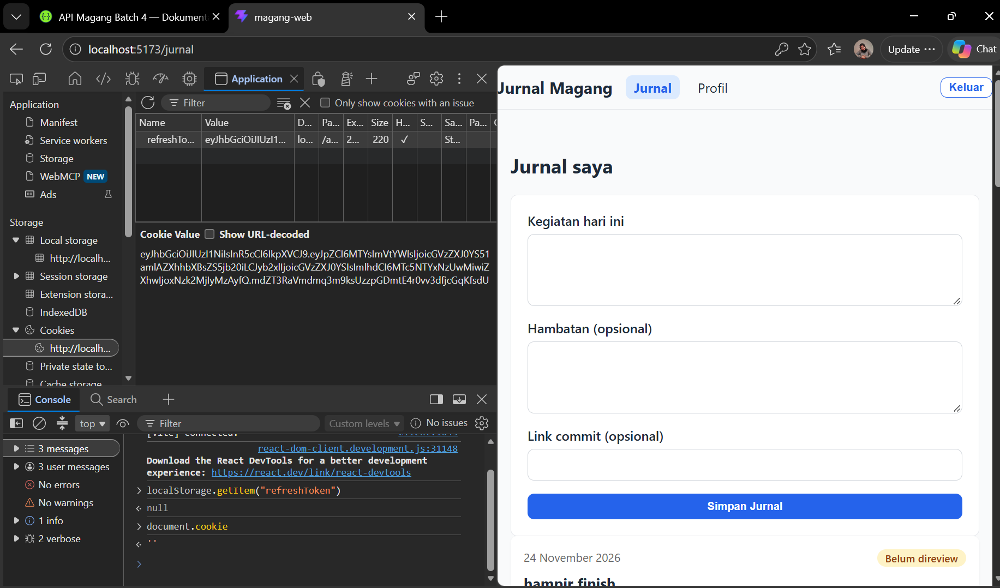
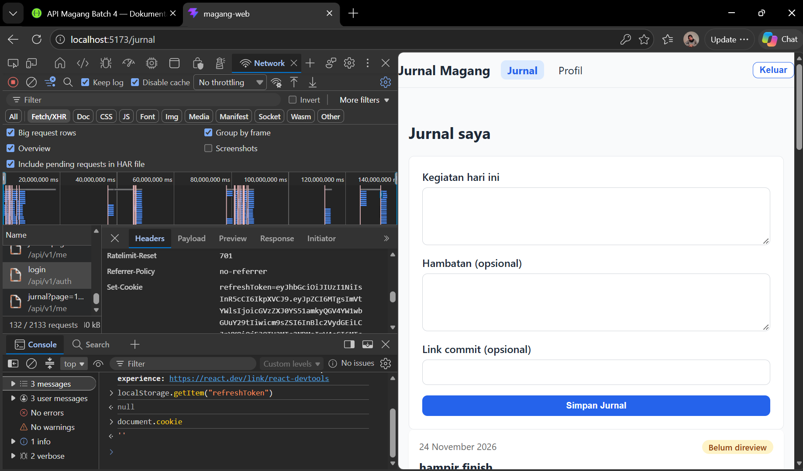

# API Magang Batch 4

## Setup Database dari Nol

1. Install PostgreSQL 16.
2. Buat database:

   ```sql
   CREATE DATABASE magang_db;
   ```

3. Jalankan migration:

   ```bash
   npm run migration:run
   ```

4. Jalankan server:

   ```bash
   npm run dev
   ```

## Endpoint Auth

### POST /api/v1/auth/register

Registrasi peserta baru.

**Body:**

```json
{
  "nama": "Test Refresh",
  "sekolah": "SMK Test",
  "email": "testrefresh@example.com",
  "password": "rahasia123"
}
```

**Response 201:**

```json
{
  "sukses": true,
  "pesan": "Registrasi berhasil",
  "data": {
    "id": 9,
    "nama": "Test Refresh",
    "email": "testrefresh@example.com",
    "role": "peserta"
  }
}
```

### POST /api/v1/auth/login

Login dan dapatkan access token beserta refresh token.

**Body:**

```json
{
  "email": "testrefresh@example.com",
  "password": "rahasia123"
}
```

**Response 200:**

```json
{
  "sukses": true,
  "pesan": "Login berhasil",
  "data": {
    "accessToken": "eyJhbGciOiJIUzI1NiIsInR5cCI6IkpXVCJ9...",
    "refreshToken": "eyJhbGciOiJIUzI1NiIsInR5cCI6IkpXVCJ9...",
    "peserta": {
      "id": 9,
      "nama": "Test Refresh",
      "sekolah": "SMK Test",
      "email": "testrefresh@example.com",
      "fase": 1,
      "status": "aktif",
      "role": "peserta"
    }
  }
}
```

### POST /api/v1/auth/refresh

Tukar refresh token dengan access token baru.

**Body:**

```json
{
  "refreshToken": "eyJhbGciOiJIUzI1NiIsInR5cCI6IkpXVCJ9..."
}
```

**Response 200:**

```json
{
  "sukses": true,
  "pesan": "Access token berhasil diperbarui",
  "data": {
    "accessToken": "eyJhbGciOiJIUzI1NiIsInR5cCI6IkpXVCJ9..."
  }
}
```

### POST /api/v1/auth/logout

Hapus refresh token dari database.

**Body:**

```json
{
  "refreshToken": "eyJhbGciOiJIUzI1NiIsInR5cCI6IkpXVCJ9..."
}
```

**Response 200:**

```json
{
  "sukses": true,
  "pesan": "Logout berhasil"
}
```

## Kenapa DELETE Harus Idempotent

DELETE harus idempotent karena kalau kita menghapus data yang sama berkali-kali, hasilnya tetap sama, yaitu data tersebut terhapus. Hal ini membuat sistem menjadi lebih terprediksi, sehingga client bisa mencoba ulang permintaan DELETE tanpa khawatir menimbulkan efek ganda. Berbeda dengan POST yang akan membuat data baru setiap kali dipanggil.

## Kenapa Tidak Boleh Menghapus Lewat GET

GET harus selalu bersifat "safe", artinya tidak mengubah data apa pun. Apabila ada endpoint seperti GET /peserta/1/hapus, browser atau crawler bisa memanggilnya secara otomatis (misalnya melalui prefetch atau cache) tanpa kita sadari. Akibatnya data bisa terhapus tanpa ada yang menekan tombol apa pun. Itulah sebabnya aksi yang mengubah data harus menggunakan POST, PUT, PATCH, atau DELETE.

## Perbedaan Entity dan DTO

Entity adalah bentuk tabel yang ada di database. Field-nya lengkap, mulai dari id, password, sampai waktu pembuatan data. Satu entity mewakili satu tabel.

DTO adalah bentuk data yang diizinkan masuk atau keluar dari API. Field-nya hanya yang relevan untuk kebutuhan tertentu. Satu entity bisa memiliki beberapa DTO, misalnya untuk pendaftaran, pembaruan, dan respons.

Entity Peserta tidak sebaiknya dipakai langsung sebagai bentuk data pendaftaran, karena tiga alasan berikut:

1. Pengguna bisa saja mengirim field yang tidak seharusnya, seperti `role` atau `id`.
2. Data password yang sudah di-hash bisa ikut terkirim di respons jika kurang berhati-hati.
3. Apabila struktur database berubah, kontrak API akan langsung terganggu.

## Perbedaan Express 5

Proyek ini menggunakan Express versi 5.2.1. Ada beberapa hal yang berbeda dari versi sebelumnya:

1. `req.query` bersifat hanya-baca, sehingga tidak dapat ditimpa. Oleh karena itu, hasil validasi saya simpan di `req.validated`.
2. `req.body` bernilai `undefined` apabila permintaan tidak memiliki body, bukan berupa objek kosong. Middleware perlu menangani kondisi ini.
3. Sintaks path route mengalami perubahan. Pola regex seperti `/:id(\d+)` dan parameter opsional `/:bulan?` sudah tidak didukung lagi.

## Refleksi — Menguji Perilaku, Bukan Implementasi

Test yang baik memeriksa **apa yang terjadi** (hasil, error yang dilempar, efek samping), bukan **bagaimana caranya** (method apa yang dipanggil, argumen persisnya). Contoh terlalu detail: `expect(repo.findOne).toHaveBeenCalledWith({ where: { id: 1 }, relations: { jurnalList: true, skills: true } })` — test ini patah setiap kali cara query diubah, padahal perilakunya sama. Versi sehatnya: `expect(hasil).toEqual(peserta)` dan `expect(repo.save).not.toHaveBeenCalled()` saat email duplikat — memeriksa hasil akhir dan efek penting, bukan rantai pemanggilan.

## Cara Menjalankan Test

### 1. Persiapan Awal (Instalasi Dependency)

Sebelum menjalankan test, pastikan semua library yang dibutuhkan sudah terpasang di dalam project. Jika belum, jalankan perintah:

```bash
npm install
```

### 2. Unit & HTTP Test (Cepat, Tanpa Database)

Pengujian ini berfokus pada logika fungsi, validasi DTO, controller, dan kontrak API menggunakan mock (tanpa koneksi database asli).

**Perintah:**

```bash
npm test
```

**Output Terminal:**

```text
> api-magang@1.0.0 test
> jest

Test Suites: 15 passed, 15 total
Tests:       180 passed, 180 total
Snapshots:   0 total
Time:        13.509 s
Ran all test suites.
```

### 3. Test Coverage (Melihat Persentase Kode yang Teruji)

Pengujian ini dijalankan untuk melihat seberapa besar kode yang sudah tercakup oleh test, sekaligus memastikan angka tersebut lolos dari batas minimal (threshold) yang ditetapkan sebesar 60%.

**Perintah:**

```bash
npm run test:coverage
```

**Output Terminal:**

```text
> api-magang@1.0.0 test:coverage
> jest --coverage

Test Suites: 15 passed, 15 total
Tests:       180 passed, 180 total
Snapshots:   0 total
Time:        19.796 s
Ran all test suites.
All files        80.66 |    68.05 |   65.69 |   81.26 |
```

### 4. Integration Test (Membutuhkan Database Asli)

Pengujian ini memastikan alur aplikasi berjalan dengan baik saat terhubung langsung ke database PostgreSQL. Test ini akan menghapus dan membuat ulang skema database dari nol menggunakan migration.

Langkah pertama, pastikan service PostgreSQL menyala dan buat database khusus test (jika belum ada):

```bash
psql -U postgres -c "CREATE DATABASE magang_test;"
```

Langkah kedua, jalankan perintah test integrasi:

```bash
npm run test:int
```

**Output Terminal:**

```text
> api-magang@1.0.0 test:int
> jest --config jest.integration.config.ts --runInBand

PASS  tests/integration/auth-flow.test.ts
  Alur autentikasi lengkap (database sungguhan)
    √ register, login, akses /me, tolak mass assignment, refresh, logout, refresh ditolak (330 ms)
    √ menolak email duplikat walau beda huruf besar dan spasi (409) (137 ms)
    √ dua register bersamaan dengan email sama: satu 201, satu 409 (UNIQUE constraint) (196 ms)

PASS  tests/integration/peserta-jurnal.test.ts
  Alur peserta & jurnal (database sungguhan)
    √ GET /peserta dengan 15 data: pagination dan filter bekerja
    √ DELETE /peserta/:id yang masih punya jurnal — perilaku ON DELETE

Test Suites: 2 passed, 2 total
Tests:       5 passed, 5 total
Snapshots:   0 total
Time:        5.157 s
Ran all test suites.
```

## Konsep OpenAPI dan Swagger (Minggu 16 - Senin)

OpenAPI adalah **spesifikasi** atau standar format (berupa JSON/YAML) untuk mendeskripsikan bentuk REST API. Sedangkan Swagger adalah **kumpulan alat** (tools) yang menggunakan standar OpenAPI tersebut, salah satunya adalah Swagger UI yang mengubah dokumen menjadi halaman web interaktif yang bisa dicoba langsung.

Dokumen API tetap perlu dibuat meskipun kita sendiri yang menulis seluruh kodenya karena dokumentasi berfungsi sebagai **kontrak yang jelas** antara backend dan frontend. Frontend tidak perlu lagi menebak-nebak bentuk respons atau membuka kode backend untuk tahu cara memanggil API. Selain itu, dokumentasi yang baik memudahkan pengujian (QA) dan memastikan tidak ada kesalahan komunikasi saat fitur baru ditambahkan di masa depan.

## Terjemahan DTO ke OpenAPI (Minggu 16 - Selasa)

Berikut adalah contoh sinkronisasi aturan dari DTO (class-validator) ke dalam skema dokumentasi OpenAPI:

1. `@MinLength(10)` pada DTO kegiatan → `minLength: 10` pada CreateJurnalRequest.
2. `@IsIn(["belum", "sudah"])` pada DTO statusReview → `enum: ["belum", "sudah"]` pada ReviewJurnalRequest.
3. `@IsUrl()` pada DTO linkCommit → `type: "string", format: "uri"` pada Jurnal.

## Terjemahan DTO ke OpenAPI

Berikut adalah sinkronisasi aturan validasi dari DTO (class-validator) ke dalam skema dokumentasi OpenAPI:

| Decorator DTO (class-validator) | Keyword OpenAPI (Swagger) |
|---|---|
| `@IsString()` | `type: string` |
| `@IsEmail()` | `type: string, format: email` |
| `@MinLength(10)` | `minLength: 10` |
| `@MaxLength(200)` | `maxLength: 200` |
| `@Min(1)` / `@Max(5)` | `minimum: 1` / `maximum: 5` |
| `@IsIn(["belum", "sudah"])` | `enum: ["belum", "sudah"]` |
| `@IsUrl()` | `type: string, format: uri` |
| `@IsBoolean()` | `type: boolean` |
| `@IsOptional()` | Properti tidak dimasukkan ke array `required` |
| `@ValidateNested()` | Menggunakan `$ref` ke schema lain |

## Minggu 20 — Menyimpan Token: Serangan XSS & Migrasi ke Cookie httpOnly

### Soal 1 — Eksperimen Pencurian Refresh Token

Pada versi sebelumnya, refresh token disimpan di `localStorage`, sehingga token dapat dibaca oleh JavaScript melalui browser Console.

Hasil eksperimen:
- Refresh token berhasil ditampilkan melalui `localStorage`.
- Token yang diperoleh dapat digunakan kembali melalui `curl` untuk memanggil endpoint refresh tanpa harus login ulang melalui browser.
- Refresh token memiliki masa berlaku selama 7 hari.
- Selama token masih valid dan belum dicabut, pihak yang berhasil mencurinya berpotensi mendapatkan access token baru dan melakukan tindakan melalui API sesuai hak akses akun korban.

**Kesimpulan:** Menyimpan refresh token di `localStorage` berisiko karena JavaScript yang berjalan akibat serangan XSS dapat membaca dan mengambil token tersebut.

### Soal 2 — Perbandingan Tempat Penyimpanan Token

| Tempat penyimpanan | Terbaca JavaScript? | Bertahan setelah reload? | Risiko | Cocok untuk |
|---|---|---|---|---|
| Variabel memori | Ya | Tidak | Hilang ketika halaman dimuat ulang | Access token |
| `localStorage` | Ya | Ya | Token dapat dicuri melalui XSS | Data biasa yang tidak sensitif |
| `sessionStorage` | Ya | Selama sesi tab berlangsung | Tetap dapat dibaca melalui XSS | Data sementara per tab |
| Cookie biasa | Ya | Ya, sesuai masa berlaku | Dapat dibaca JavaScript dan berisiko terhadap XSS | Data non-sensitif yang perlu dikirim otomatis |
| Cookie `HttpOnly` | Tidak | Ya, sesuai masa berlaku | Browser mengirim cookie otomatis sehingga tetap perlu perlindungan CSRF | Refresh token |

**Kesimpulan:** Access token disimpan di memori aplikasi, sedangkan refresh token disimpan dalam cookie `HttpOnly` agar tidak dapat dibaca langsung oleh JavaScript.

### Soal 3 — Migrasi Refresh Token ke Cookie HttpOnly

Perubahan yang dilakukan pada backend:

- Menambahkan middleware `cookie-parser`.
- Membuat helper untuk mengatur dan menghapus cookie refresh token.
- Mengatur cookie dengan atribut `HttpOnly`, `Secure` sesuai konfigurasi, `SameSite=Strict`, dan `Path=/api/v1/auth`.
- Login mengirim refresh token melalui header `Set-Cookie`, bukan melalui response body.
- Endpoint refresh membaca token dari cookie.
- Endpoint logout mencabut refresh token dan menghapus cookie.
- Masa berlaku access token dapat diatur melalui environment variable `JWT_ACCESS_EXPIRES_IN`.

### Soal 4 — Pengujian Menggunakan curl dan Cookie Jar

Pengujian dilakukan menggunakan `curl` dengan cookie jar `jar.txt`.

Hasil pengujian:
- Login berhasil dan server mengirim refresh token melalui header `Set-Cookie`.
- Cookie jar digunakan untuk menyimpan cookie hasil login.
- Endpoint refresh berhasil dipanggil menggunakan cookie dari cookie jar.
- Logout berhasil dengan response **204 No Content**.
- Setelah logout, pemanggilan endpoint refresh kembali menghasilkan **401 Unauthorized** karena refresh token sudah dicabut.

**Kesimpulan:** Refresh token dapat digunakan melalui cookie tanpa perlu dikirim di request body. Setelah logout, token tidak dapat digunakan kembali.

### Soal 5 — Dokumentasi API dan Pengujian

Perubahan dokumentasi dan pengujian yang dilakukan:

- Memperbarui skema OpenAPI untuk login, refresh, dan logout.
- Menambahkan skema autentikasi cookie `refreshToken`.
- Menghapus kebutuhan request body pada endpoint refresh dan logout.
- Memperbarui tipe API frontend menggunakan hasil export OpenAPI.
- Memperbarui integration test agar menggunakan cookie melalui `request.agent(app)`.

Hasil pengujian:
- Integration test: **2 test suites passed, 5 tests passed**.
- Seluruh test: **17 test suites passed, 184 tests passed**.
- Lint: **0 warnings dan 0 errors**.
- Build TypeScript dan Vite berhasil.

### Soal 6 — Bukti di Browser

Pemeriksaan dilakukan melalui Developer Tools setelah login.

Hasil pemeriksaan:
- `localStorage.getItem("refreshToken")` tidak menemukan refresh token.
- `document.cookie` tidak menampilkan refresh token karena cookie menggunakan atribut `HttpOnly`.
- Pada bagian Application → Cookies, refresh token tersimpan dengan atribut `HttpOnly`, `SameSite=Strict`, dan `Path=/api/v1/auth`.
- Pada Network, response login mengirim cookie melalui header `Set-Cookie`.
- Response body login hanya berisi `accessToken` dan data peserta, tanpa refresh token.
- Request refresh tanpa cookie menghasilkan **401 Unauthorized**.

**Bukti screenshot:**
**Screenshot 1 — Application (Cookie HttpOnly)**



**Screenshot 2 — Console (Pemeriksaan Token)**



### Soal 7 — Dampak HttpOnly terhadap Serangan XSS

Cookie `HttpOnly` membuat JavaScript tidak bisa membaca refresh token secara langsung, tetapi browser tetap mengirim cookie tersebut secara otomatis ke endpoint `/api/v1/auth`. Jika masih terjadi serangan XSS, script berbahaya tetap bisa menjalankan `fetch("/api/v1/auth/refresh", { method: "POST" })` dan mendapatkan access token baru selama halaman korban masih terbuka. Dengan access token tersebut, penyerang masih bisa melakukan tindakan melalui API atas nama korban. Perbedaannya, refresh token tidak bisa dibaca lalu dibawa keluar browser untuk digunakan dari perangkat lain selama masa berlakunya. Jadi, `HttpOnly` hanya mengurangi dampak pencurian token, bukan menghilangkan risiko XSS sepenuhnya. Pencegahan XSS tetap perlu dilakukan dengan memanfaatkan escaping otomatis React, menghindari `dangerouslySetInnerHTML`, menerapkan Content Security Policy (CSP), dan memperbarui dependensi.

### Soal 8 — Perubahan yang Mematahkan Klien

Perubahan kontrak API setelah migrasi:

- Login tidak lagi mengembalikan `refreshToken` di response body. Refresh token dikirim melalui header `Set-Cookie`.
- Endpoint refresh tidak lagi membutuhkan request body karena token dibaca dari cookie.
- Endpoint logout tidak lagi membutuhkan request body.
- Logout mengembalikan status **204 No Content**.
- Ditambahkan environment variable `JWT_ACCESS_EXPIRES_IN` untuk mengatur masa berlaku access token dan `COOKIE_SECURE` untuk mengatur atribut Secure pada cookie.

Perubahan ini dilakukan untuk mengurangi risiko pencurian refresh token melalui JavaScript. Karena aplikasi masih dalam tahap pengembangan dan belum memiliki klien produksi yang perlu mempertahankan kontrak lama, perubahan diterapkan langsung pada API v1.

